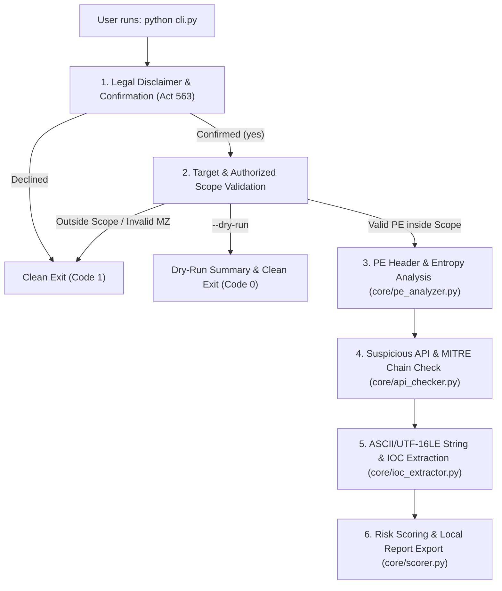

# MalScope (PE-Sentry) - Static PE Header Inspector & IOC Extractor

**Course:** IKB31603 - Ethical Hacking (UniKL MIIT)  
**Attack Category:** Category 7 - Malware (*Static Malware Analyzer, PE Header Inspector & IOC Extractor*)

---

## 1. Overview & Description
**MalScope (PE-Sentry)** is an offline, command-line static malware triage tool for Windows Portable Executable (`.exe`, `.dll`) files. Rather than executing potentially dangerous binaries, MalScope inspects the raw PE structure on disk to:
1. **Enforce Ethical Guardrails (`cli.py`):** Displays a startup legal disclaimer referencing Malaysia's Computer Crimes Act 1997 (Act 563), requires explicit user confirmation, restricts file inspection to an authorized directory scope (`--scope`), defaults to a safe test sample (`samples/dummy_test.exe`), supports `--dry-run`, and provides a clean `Ctrl+C` (`SIGINT`) kill switch.
2. **Inspect PE Structure & Section Entropy (`core/pe_analyzer.py`):** Parses DOS, COFF, Optional, and Section headers via `pefile` and calculates Shannon entropy ($0.0\text{–}8.0$ bits/byte) per section to flag packed or encrypted payloads ($\ge 7.0$).
3. **Detect Suspicious Windows APIs & MITRE ATT&CK Chains (`core/api_checker.py`):** Evaluates the Import Address Table (`DIRECTORY_ENTRY_IMPORT`) against 5 threat categories, flags multi-API behavioral chains (e.g., `T1055` Process Injection, `T1055.012` Process Hollowing, `T1105` Remote Payload Dropper), and checks for IAT anomalies.
4. **Extract Indicators of Compromise (`core/ioc_extractor.py`):** Extracts printable ASCII and UTF-16LE strings and applies regular expressions + validation filters to identify embedded URLs, IPv4 addresses, domains, and Windows Registry keys.
5. **Compute Risk Score & Save Local Reports (`core/scorer.py`):** Aggregates static indicators into a risk rating (`LOW`, `MEDIUM`, `HIGH`) and writes labeled reports locally to `output/`.

---

## 2. Architecture & System Flow



---

## 3. Attack Lifecycle Mapping
MalScope maps static binary indicators to the **Cyber Kill Chain** and **MITRE ATT&CK** framework:

| Lifecycle Stage | Static Artifacts Inspected by MalScope |
| :--- | :--- |
| **Weaponization** | PE compile timestamps, linker metadata, high Shannon entropy ($\ge 7.0$) indicating packers/crypters, and missing/sparse Import Address Tables (`T1027`). |
| **Installation & Persistence** | Registry modification APIs (`RegSetValueEx`, `RegCreateKeyEx`), service creation APIs (`CreateService`), and hardcoded `HKLM`/`HKCU` Run keys. |
| **Execution & Defense Evasion** | Process injection/hollowing API chains (`VirtualAllocEx` + `WriteProcessMemory` + `CreateRemoteThread` / `T1055`), debugger checks (`IsDebuggerPresent`), and dynamic API resolution (`LoadLibrary` + `GetProcAddress` / `T1027.007`). |
| **Command & Control (C2)** | Networking APIs (`InternetOpenUrl`, `URLDownloadToFile`, `WSAStartup`, `connect`) and embedded IPv4 addresses, URLs, and domains. |
| **Actions on Objectives** | Keylogging/hook APIs (`SetWindowsHookEx`, `GetAsyncKeyState` / `T1056.001`) and credential decryption APIs (`CryptUnprotectData`). |

---

## 4. Setup & Installation

### Prerequisites
- **Python 3.10+**
- **Git**

### Step-by-Step Setup (Windows PowerShell)
1. **Clone the repository and enter the project folder:**
   ```powershell
   git clone https://github.com/iqbal-labqi/malscope-pe-analyzer.git
   cd malscope-pe-analyzer
   ```

2. **Create and activate a Python virtual environment:**
   ```powershell
   python -m venv .venv
   .\.venv\Scripts\Activate.ps1
   ```

3. **Install required dependencies (`pefile`, `colorama`):**
   ```powershell
   pip install -r requirements.txt
   ```

---

## 5. How to Run & Usage Examples

### View Help & CLI Flags
```powershell
python cli.py --help
```

### 1. Run with Safe Default Target (`samples/dummy_test.exe`)
By default, MalScope targets the included benign test binary inside the authorized `samples/` directory:
```powershell
python cli.py
```
When prompted, type `yes` to confirm authorization.

### 2. Run in Dry-Run Mode (Validate Scope & Target Only)
```powershell
python cli.py --target samples/dummy_test.exe --dry-run
```

### 3. Analyze a Specific PE File Inside an Authorized Scope
```powershell
python cli.py -t samples/dummy_test.exe -s samples -o output
```

### Example Terminal Output
```text
==============================================================
  MalScope (PE-Sentry) - Static PE Analyzer & IOC Extractor
  IKB31603 Ethical Hacking | Category 7: Malware (Static)
==============================================================

[LEGAL DISCLAIMER & AUTHORIZATION]
...
Do you confirm you have authorization to proceed? (yes/no): yes

[+] Target validated: D:\Hazael\Project\malscope-pe-analyzer\samples\dummy_test.exe
[+] Output directory: D:\Hazael\Project\malscope-pe-analyzer\output
[+] PE Structure & Entropy analysis complete.

--- PE Header Summary ---
  DOS Magic     : 0x5a4d (e_lfanew: 0x80)
  Format        : PE32 (32-bit) | Machine: x86 (32-bit)
  Subsystem     : Windows Console (CUI)
  Entry Point   : 0x1000 | Image Base: 0x400000
  Compile Time  : 2024-10-04 14:47:28 UTC
  Sections (2)  :
  Name       VirtAddr   RawSize    Entropy  Assessment
  ----------------------------------------------------------------
  .text      0x1000     512        0.2112   LOW (Sparse/padding)
  .rdata     0x2000     512        1.8563   NORMAL
[+] Suspicious API check complete.
...
[+] IOC extraction complete.

--- Extracted IOCs Summary ---
  Printable Strings : 7
  Total IOCs Found  : 4
  URLs              : 1
      - http://example.com/healthcheck
  IPv4 Addresses    : 1
      - 127.0.0.1
  Domains           : 1
      - example.com
  Registry Keys     : 1
      - HKEY_CURRENT_USER\Software\MalScopeTest
[+] Risk scoring & local report saved to output.

--- Final Risk Assessment & Local Report ---
  SHA-256 Hash    : f447f6ef4aa66e2feee6fdb94aa0a471e7d0615e171f58645adfdd851d8c08ea
  Risk Score      : 21 / 100
  Risk Rating     : LOW
  Score Breakdown :
      * +10 pts: 1 Import Address Table anomaly/anomalies
      * +5 pts: 1 Windows Registry key indicator(s)
      * +6 pts: 3 benign loopback/example test IOC(s)
  Saved JSON      : output\malscope_report_dummy_test_20261117_201047.json
  Saved TXT       : output\malscope_report_dummy_test_20261117_201047.txt
```

### Screenshot of the Terminal via Safe Defaults (samples/...exe)


---

## 6. Ethical Considerations & Rules of Engagement (RoE)

### Rules of Engagement (RoE)
- **Authorized Scope:** Analysis is restricted strictly to files located inside the designated `--scope` directory (default: `./samples/`). Attempting to inspect system binaries (e.g., `C:\Windows\System32`) or files outside `--scope` is blocked automatically.
- **Time Windows:** For academic assessment and authorized lab sessions during the IKB31603 course period, or within explicitly approved incident-response engagement windows.
- **Permitted Techniques:** Passive, offline static file inspection (PE header parsing, Shannon entropy calculation, IAT inspection, and string/regex extraction).
- **Prohibited Actions:**
  - Executing, launching, or dynamically debugging live malware on host machines outside an isolated sandbox.
  - Scanning unauthorized third-party hosts, shares, or production directories.
  - Uploading sensitive binaries or extracted IOCs to third-party cloud services without written owner consent.
- **Emergency Stop Procedures (Kill Switch):** Press `Ctrl+C` (`SIGINT`) at any point to trigger `handle_kill_switch()`, which immediately halts processing, closes file handles, and exits cleanly with code `130`.

### Data Handling
- **Zero Exfiltration:** MalScope operates 100% offline and makes **no outbound network requests**.
- **Local Storage:** All generated reports are stored locally in the `./output/` directory with clear timestamps and labeling, and are excluded from version control via `.gitignore`.

### Responsible Disclosure Guidance
If a genuinely malicious binary, vulnerability, or active C2 indicator is discovered during an authorized engagement:
1. **Who to Notify:** Report immediately to the system/asset owner, institutional CSIRT/SOC, or national CERT (e.g., **MyCERT / CyberSecurity Malaysia** via `cyber999@cybersecurity.my`) and the supervising lecturer for academic findings.
2. **When to Notify:** Within **24–48 hours** of verifying the indicator, before any public discussion or repository publication.
3. **How to Disclose:** Provide a confidential report containing cryptographic hashes (SHA-256), extracted IOCs, affected scope, and remediation steps. Never publish live malware samples or sensitive victim data in public repositories.

---

## 7. Legal Disclaimer & Limitations

### Legal Disclaimer
> This tool is developed strictly for educational purposes under **UniKL MIIT IKB31603 (Ethical Hacking)** and for authorized static malware triage. Unauthorized access, interception, or modification of computer materials is an offence under **Malaysia's Computer Crimes Act 1997 (Act 563)**. The authors assume no liability for misuse or damage caused by this software.

### Limitations
- **Static-Only Analysis:** MalScope does not execute the binary; runtime-decrypted payloads or APIs resolved solely via custom hashing will not appear in the static Import Address Table.
- **PE Format Specific:** Designed for Windows Portable Executables (`MZ` / `PE32` / `PE32+`); ELF, Mach-O, and script-based malware are out of scope.
- **String False Positives:** Regex-based string extraction may match benign URLs or version strings present in legitimate software libraries.

---

## 8. License
Distributed under the [MIT License](LICENSE).
